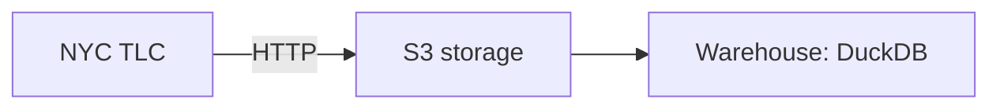

# nyc-taxi-elt

[](https://github.com/patuh-istizhar/nyc-taxi-elt/actions/workflows/ci.yml)

NYC TLC trip data is streamed to **S3-compatible storage** as raw parquet, then
loaded into a **DuckDB warehouse**, orchestrated by **Prefect**.

| Environment | S3 storage | Warehouse | Orchestration |
|-------------|------------|-----------|---------------|
| **dev**     | [RustFS](https://github.com/rustfs/rustfs) via docker compose | Local DuckDB file | Prefect (local) |
| **prod**    | Any S3 API (Backblaze B2, Cloudflare R2, AWS S3) | MotherDuck (`md:`) | Prefect Managed |



## Layout

```
nyc_taxi_elt/
  config.py            settings from env vars / Prefect Secret blocks
  months.py            month arithmetic + parsing (YYYY-MM)
  tlc.py               NYC TLC source: taxi types, file names, table layouts
  s3.py                S3 helpers: client, bucket, HTTP -> S3 streaming upload
  warehouse/
    connection.py      open DuckDB / MotherDuck, SQL quoting
    loader.py          schema-aware, idempotent parquet load + audit
    views.py           pipeline_health / trip_months views
  flows/
    ingest.py          Prefect flow `nyc-taxi-ingest` + CLI
    smoke.py           Prefect flow `nyc-taxi-smoke`
```

## How it works

- Without a month, a run loads every incomplete month in the last six months,
  newest first, so a month TLC published late is not stuck behind a newer one.
- With `start_month` (and optionally `end_month`) it loads that month or every month
  in the range (backfill), oldest first. Months already loaded are skipped; `force`
  reloads them.
- A source file that is not published yet (HTTP 403/404): scheduled runs stay green
  while the month is within three months of the run date; explicit months load
  everything that exists and then fail listing the missing files.
- Reloading a file deletes its previous rows first, so runs are idempotent. A failed
  load rolls back and keeps the old data.
- Source columns outside the known schema are added automatically; known columns
  missing from a file are stored as `NULL`; missing required columns fail the run.
- Hard failures: row count mismatch, duplicate ids, null timestamps, more than 1% of
  pickups outside the month.
- Warnings only: out-of-month pickups, dropoff before pickup, negative totals, and
  timestamps more than a month outside the file's month.
- Every load writes to `pipeline_runs` and publishes a Prefect artifact
  (`nyc-taxi-<YYYY-MM>`).


## Warehouse objects

| Object | Contents |
|---|---|
| `{schema}.yellow_tripdata` | yellow trips, one row per unique trip |
| `{schema}.green_tripdata` | green trips |
| `{schema}.pipeline_runs` | audit log of every load (rows, size, sha256, warnings) |
| `{schema}.pipeline_health` | latest load per month/type, `days_since_load`, `months_behind` |
| `{schema}.trip_months` | rows, pickup range and `suspicious_rows` per file |

```sql
SELECT trip_month, taxi_type, rows_in_table, months_behind, last_run
FROM nyc_taxi.pipeline_health
ORDER BY trip_month DESC;
```

Row id is `MD5(VendorID, pickup, dropoff, PULocationID, DOLocationID)`.

---

## Dev

```bash
docker compose up -d --wait      # RustFS on :9000 (console :9001, rustfsadmin/rustfsadmin)
cp .env.example .env             # defaults: local RustFS + ./data/nyc_taxi.duckdb
uv sync

uv run --env-file .env python -m nyc_taxi_elt.flows.smoke

# one month
uv run --env-file .env python -m nyc_taxi_elt.flows.ingest --taxi-type green --month 2024-01

# backfill a range (inclusive); taxi type defaults to all
uv run --env-file .env python -m nyc_taxi_elt.flows.ingest --from 2023-01 --to 2023-12

# reload even if already loaded
uv run --env-file .env python -m nyc_taxi_elt.flows.ingest --month 2024-01 --force

# what the schedule does: every incomplete month in the last six
uv run --env-file .env python -m nyc_taxi_elt.flows.ingest
```

The bucket is created automatically in dev. Query the warehouse:

```bash
uv run python -c "import duckdb; print(duckdb.connect('data/nyc_taxi.duckdb').sql('SELECT * FROM nyc_taxi.pipeline_health'))"
```

Runs go to an ephemeral local Prefect server. To watch them in a UI, run
`uv run prefect server start` in another terminal and
`uv run prefect config set PREFECT_API_URL=http://127.0.0.1:4200/api` first.

---

## Prod

Prod config lives in [`prefect.yaml`](prefect.yaml) (`ENV=prod`, S3 endpoint, bucket,
`WAREHOUSE_DATABASE=md:nyc_taxi`, `WAREHOUSE_SCHEMA=zoomcamp`) and runs on a
Prefect Managed work pool that clones this repo.

One-time setup (Prefect Cloud):

```bash
uv run prefect cloud login
uv run prefect work-pool create managed-pool --type prefect:managed
# Secret blocks read by the flows
uv run python -c "
from prefect.blocks.system import Secret
Secret(value='<s3 key id>').save('s3-access-key-id', overwrite=True)
Secret(value='<s3 secret key>').save('s3-secret-access-key', overwrite=True)
Secret(value='<motherduck token>').save('motherduck-token', overwrite=True)
"
```

Deploy and run:

```bash
uv run prefect deploy --all                                   # after every push that changes flows
uv run prefect deployment run nyc-taxi-smoke/smoke
uv run prefect deployment run nyc-taxi-ingest/weekly          # same as the schedule
uv run prefect deployment run nyc-taxi-ingest/weekly \
  --param start_month=2023-01 --param end_month=2023-12       # backfill
uv run prefect deployment run nyc-taxi-ingest/weekly \
  --param start_month=2024-01 --param force=true              # reload one month
```

You can also run prod from your machine: put the prod values in a `.env.prod`
and use `uv run --env-file .env.prod python -m nyc_taxi_elt.flows.ingest ...`.

---

## Environment variables

| Variable | Dev default | Prod | Description |
|---|---|---|---|
| `ENV` | `dev` | `prod` | dev = defaults + auto-create bucket |
| `S3_ENDPOINT_URL` | `http://127.0.0.1:9000` | provider URL | Empty = AWS S3 |
| `S3_REGION` | `us-east-1` | *required* | |
| `S3_ACCESS_KEY_ID` | — | env or block `s3-access-key-id` | |
| `S3_SECRET_ACCESS_KEY` | — | env or block `s3-secret-access-key` | |
| `S3_BUCKET` | `nyc-taxi` | *required* | |
| `WAREHOUSE_DATABASE` | `./data/nyc_taxi.duckdb` | *required*, e.g. `md:nyc_taxi` | File path or `md:<db>` |
| `WAREHOUSE_SCHEMA` | `nyc_taxi` | `zoomcamp` (existing data) | Schema for all tables |
| `MOTHERDUCK_TOKEN` | — | env or block `motherduck-token` | Only for `md:` |
| `TLC_BASE_URL` | CloudFront URL | same | TLC data root |

---

## Checks

```bash
uv run pytest -q
uv run ruff check . && uv run ruff format --check .
```

CI (`.github/workflows/ci.yml`) runs an import check, ruff and pytest on every
push and pull request.
